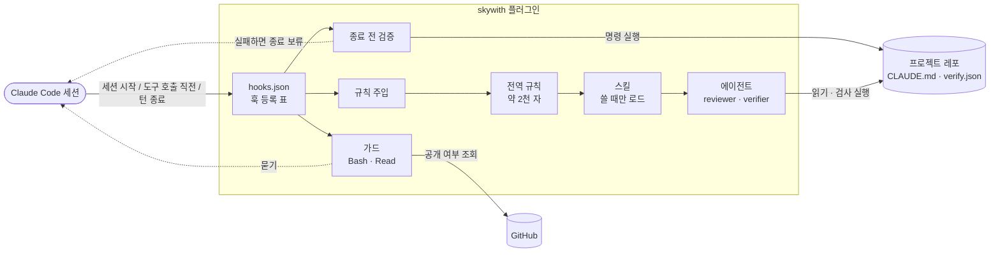

# skywith — Claude Code 하네스
> Claude Code가 규칙을 잊어도 지켜지게 만든 개인 플러그인. 위험한 명령은 실행 전에 묻고, 턴을 끝내기 전에는 프로젝트의 검사를 돌립니다.

실제 세션에서 나온 출력입니다. 위는 가드가 명령을 멈춘 것이고, 아래는 검증이 실패해 종료가 보류된 것입니다.
```text
> Bash: git reset --hard
skywith 가드: `git reset --hard`다. 커밋하지 않은 변경이 사라진다.

> (Claude가 턴을 끝내려 함)
완료 전 검증 실패 (.claude/verify.json): `make lint` → 1
원인을 고친 뒤 끝낸다. 지금 고칠 수 없으면 실패한 명령과 출력을 사용자에게 그대로 보고하고 끝낸다.
```

## 📌 만든 이유
전역 규칙에 "푸시 전에 레포 공개 여부를 확인한다"고 적어 두었는데도, 공개 레포에 작업 중인 브랜치가 올라간 일이 있었습니다. 글로 쓴 규칙은 모델이 읽고 따라 주어야 지켜집니다. 대부분은 지켜지지만 보장은 없습니다.

그래서 규칙을 둘로 나눴습니다. 꼭 지켜져야 하는 것은 Claude Code가 직접 실행하는 훅으로 옮기고, 판단이 필요한 것만 글로 남겼습니다.

## 🏗 구조


| 층 | 담는 것 | 언제 로드되나 |
|---|---|---|
| 전역 규칙 | 응답 형식, 원칙, 위임 기준 | 매 세션 통째로 |
| 훅 | 규칙 주입, 가드 2개, 종료 전 검증 | Claude Code가 직접 실행 |
| 스킬 | 작업 모드, 세션 시작·마무리, 도메인 체크리스트 | 쓸 때만 본문 로드 |
| 에이전트 | 독립 리뷰어, 검증 실행 담당 | 메인 세션이 맡길 때 |

## 🛠 설계에서 고른 것
| 선택 | 이유 |
|---|---|
| 가드는 막지 않고 **묻는다** | 되돌리기 어려운 작업은 "확인받은 뒤에 한다"가 원래 규칙입니다. 사람이 없는 실행에서는 묻는 것이 곧 거부가 됩니다. |
| 검증 명령은 **프로젝트가 정한다** | 플러그인은 틀만 갖고, 무엇을 돌릴지는 각 레포의 `.claude/verify.json`에 둡니다. 파일이 없으면 훅은 아무것도 하지 않습니다. |
| 같은 작업 트리 상태는 **한 번만 검사** | 실패를 알린 뒤 아무것도 바꾸지 않고 끝내면 통과시킵니다. 고칠 수 없는 실패로 무한히 막히지 않습니다. |
| 훅은 **Node 스크립트** | Windows와 Mac 세 대에서 같은 코드로 돕니다. 의존성은 없습니다. |
| 이 레포에도 `verify.json` | 규칙이나 스킬을 고친 턴이 끝날 때 테스트가 돕니다. 하네스가 자기 자신에게도 적용됩니다. |

## 📊 확인한 수치
| 항목 | 값 | 재는 법 |
|---|---|---|
| 테스트 | 20개 통과 | `node --test tests/` |
| 항상 로드되는 규칙 길이 | 2,104자 (한도 10,000자) | `node skywith/hooks/print-rules.js` 출력 길이 |
| 가드가 Bash 호출마다 더하는 시간 | 약 80ms (맥북 한 대, 10회 평균) | 스크립트를 직접 10회 실행 |
| 위임 기준의 근거 | 서브에이전트 호출 42건 | 제 세션 기록 5개월치 집계 |
| 실수가 얼마나 줄었는가 | TBD | 적용 전후를 비교한 값이 아직 없습니다. `시마이`의 하네스 회고에 쌓이는 항목 수로 볼 예정입니다. |

## 🔧 의사결정 기록
**문제:** 에이전트에게 일을 나누는 기준을 처음에는 공식 문서만 보고 일반론으로 썼습니다.
**원인:** 실제로 어떻게 쓰고 있는지 확인하지 않았습니다.
**해결:** 세션 기록에서 서브에이전트 호출 42건을 집계해 패턴 다섯 가지를 찾고, 그중 잘 된 것만 허용 목록에 넣었습니다.
**결과:** "같은 작업 폴더에서 에이전트 여럿이 동시에 수정하지 않는다"가 규칙에 들어갔습니다. 기록에서 에이전트 셋이 공용 설정 파일 하나를 동시에 고친 사례가 나왔기 때문입니다.

<details><summary>기록에서 본 것</summary>

- 읽기 전용 점검을 병렬로 돌린 경우는 7~10분 안에 발견 사항이 수정 커밋으로 이어졌습니다.
- 작업 폴더를 나눠(worktree) 테스트를 병렬로 쓰게 한 4건은 모두 반영됐습니다. 대신 쓰고 난 폴더가 정리되지 않고 남았습니다.
- 1~2분 만에 끝난 위임이 있었습니다. 지시문을 쓰고 결과를 확인하는 비용이 더 컸습니다.
- 그래서 기본은 단일 세션으로 두고, 위임은 넓은 탐색 · 읽기 전용 점검과 리뷰 · 파일이 겹치지 않는 구현의 병렬 세 가지만 허용했습니다.
</details>

**문제:** 글로만 이어진 연결은 깨져도 오류가 나지 않습니다. 스킬 이름을 바꿔도 규칙은 옛 이름을 그대로 가리킵니다.
**해결:** 본문의 `skywith:<이름>`이 실제 스킬·에이전트를 가리키는지, `hooks.json`의 스크립트가 있는지 확인하는 테스트를 넣었습니다.
**결과:** 임시 복사본에서 스킬 폴더 이름을 바꾸고 훅 파일을 지웠더니 세 검사가 각각 깨진 위치를 짚었습니다.

## 🚀 설치
`~/.claude/settings.json`(Windows는 `%USERPROFILE%\.claude\settings.json`)에 아래를 합칩니다. 이미 있는 키는 유지합니다.
```json
{
  "extraKnownMarketplaces": {
    "skywith-local": {
      "source": { "source": "github", "repo": "SkyWith628/skywith-marketplace" },
      "autoUpdate": true
    }
  },
  "enabledPlugins": {
    "skywith@skywith-local": true
  }
}
```
Claude를 한 번 실행하면 플러그인이 설치되고, 새 세션부터 적용됩니다. 명령으로도 됩니다.
```bash
claude plugin marketplace add SkyWith628/skywith-marketplace
claude plugin install skywith@skywith-local
```
Node가 있어야 훅이 돕니다. 프로젝트에서 종료 전 검증을 켜려면 그 레포에 `.claude/verify.json`을 둡니다.
```json
{ "commands": ["npm run lint"], "timeoutSec": 120 }
```

<details><summary>제 기기에서 쓰는 추가 설정</summary>

- 인수인계 폴더: `settings.json`의 `env`에 `HANDOFF_DIR`를 넣으면 `시마이`·`드가자`가 그 폴더에 인수인계 파일을 읽고 씁니다. 기기마다 값이 다릅니다.

  | 기기 | 값 |
  |---|---|
  | Windows | `C:\\Users\\<사용자>\\iCloudDrive\\_handoff` (JSON 안에서는 `\\`) |
  | Mac | `/Users/<사용자>/Library/Mobile Documents/com~apple~CloudDocs/_handoff` |

  설정하지 않으면 스킬이 iCloud 기본 위치를 찾습니다.
- 갱신: 레포에 푸시하면 자동 갱신이 켜진 기기가 세션 시작 후 최대 10분 안에 받습니다. 바로 받으려면 `claude plugin marketplace update skywith-local` 다음에 `claude plugin update skywith@skywith-local`.
- 확인: 첫 응답이 역할 태그(`[🏗️ 아키텍트]` 등)로 시작하면 규칙이 들어온 것입니다.
</details>

스킬·에이전트·훅 각각의 설명과 수정 방법은 [skywith/README.md](skywith/README.md)에 있습니다.

## 💡 한계와 다음
- 가드는 완전한 셸 파서가 아닙니다. 스크립트 파일 안에서 실행되는 명령은 보지 못합니다.
- `verify.json`의 명령은 턴이 끝날 때 자동으로 실행됩니다. 믿을 수 없는 레포를 열 때는 이 파일을 먼저 봐야 합니다.
- 효과를 숫자로 보이지 못했습니다. 지금 있는 것은 "동작한다"는 확인까지입니다.
- 전역 규칙과 스킬 본문은 제 작업 방식에 맞춰져 있어, 그대로 가져다 쓰기보다 구조를 참고하는 쪽이 맞습니다.

`skills/floorplan`과 `skills/stack-diagram`은 바깥에서 가져온 사본입니다(MIT). 출처는 각 폴더의 `UPSTREAM.md`에 있습니다.
