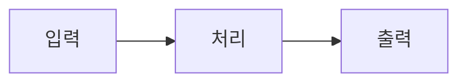

# portfolio — README & 대표 프로젝트 동기화

프로젝트에 **의미 있는 변화**(기능·구조·스택·성능)가 있을 때만 실행한다. 사소한 버그픽스 세션이면 건너뛴다.
프로필 레포: `SkyWith628/SkyWith628` (다르면 사용자에게 확인).

## 0. 시작 전 확인 — 이 스킬은 공개될 수 있는 글을 쓴다
작업을 시작하기 **전에** 아래를 한다. 하나라도 건너뛰고 진행하지 않는다.
1. **가시성 확인:** 대상 레포와 프로필 레포의 공개 여부를 `gh repo view <owner/repo> --json visibility`로 확인한다(`gh`가 없거나 확인 못 하면 공개로 간주). 프로필 레포는 항상 공개다.
2. **공개 노출 점검:** 공개 대상이면 README에 넣을 아키텍처·설계·수치·스크린샷에 내부 정보(키·`.env` 값·사설 URL/IP·고객·개인 정보·미공개 사업 내용)가 없는지 확인한다. 의심되면 그 부분을 빼거나 사용자에게 묻는다.
3. **계획을 먼저 보여주고 확인받는다:** 바꿀 README 섹션과 프로필에 넣을 항목을 요약한다. 확인 전에는 프로필 레포를 클론하거나 수정하지 않는다.
4. **푸시는 diff를 보여준 뒤 확인받고** 한다. 확인 없이 푸시하지 않는다.
5. **수치는 실측만:** 성능지표는 측정 결과(로그·리포트·재현 명령)가 있는 값만 쓴다. 없으면 `TBD(측정 예정)`로 두고 측정 방법을 제안한다. 템플릿의 예시 숫자를 그대로 쓰지 않는다. 수치에는 재현 명령이나 출처를 함께 적는다.

## 1. 프로젝트 README — 표준 포트폴리오 구조
**전제:** 포폴 README는 "어떻게 쓰나요"가 아니라 **"이 사람이 뭘 할 줄 아는가"를 30초 스캔으로 증명**하는 문서다. 채용담당자는 정독하지 않고 스캔한다 → 중요한 걸 위에, 움직이는 화면을 먼저. 아래 **우선순위 순서(= 스캔 동선)** 로 배치한다:

````markdown
# <프로젝트명>
> <한 줄 정의 — 이 프로젝트가 무엇을 하는가>

<!-- 데모 먼저. GIF/스크린샷/배포링크. AI면 추론 결과 화면. 움직이는 화면 1개 = "동작하는 걸 만들었다" 즉시 증명 -->


## 📌 문제 정의 / 만든 이유   <!-- Must -->
<왜 만들었나. 기술 나열보다 "문제 인식"이 차별화. 예: "LLM을 금전 판단에서 의도적으로 배제">

## 🛠 기술 스택 + 선정 이유   <!-- Must -->
| 기술 | 선택 이유 (핵심 2~3개만) |
|---|---|
| LightGBM | 판단 재현성 — 동일 입력 → 동일 출력 |
| ... | ... |
<!-- 배지만 나열 X. "왜 골랐나" 한 줄이 면접 질문을 만든다 -->

## 🏗 시스템 아키텍처   <!-- Must -->

<!-- 설계할 줄 아는 사람이라는 신호가 가장 강한 항목. ASCII/Mermaid면 충분 -->

## 📊 성능 지표   <!-- AI 프로젝트는 Must -->
| 지표 | 값 | 베이스라인 대비 |
|---|---|---|
| Accuracy | <실측값> | <베이스라인 대비> |
| 추론 속도 | <실측값> | <이전 → 이후> |
<!-- 예시 숫자 금지: 측정 결과(재현 명령 포함)가 있는 값만 쓴다. 없으면 "TBD(측정 예정)"로 솔직하게 둔다 -->

## 🔧 트러블슈팅 / 의사결정 기록   <!-- Should · 차별화 핵심 -->
**문제:** LLM이 같은 상품에 매번 다른 판단 (재현성 없음)
**원인:** 프롬프트 기반 판단은 본질적으로 비결정적
**해결:** 판단 로직을 LightGBM 분류 모델로 대체
**결과:** <실측으로 확인한 변화, 없으면 TBD>
<details><summary>자세한 회고 펼치기</summary>
<!-- 길게 쓰고 싶으면 여기 접어둔다. 스캔하는 사람은 4줄만, 궁금한 사람은 펼쳐 읽음 -->
</details>

## 🚀 실행 방법   <!-- Should -->
```bash
docker compose up   # 한 줄로 끝나면 재현성 챙긴 사람으로 보인다
```

## 💡 회고   <!-- Could -->
<배운 점 / 아쉬운 점 / 개선 방향 — 짧아도 성장 가능성을 보여준다>
````

**작성 원칙 (스캔 최적화)**
- **데모(움직이는 화면)를 맨 위에.** 글 100줄보다 GIF 1개가 "동작한다"를 증명. AI면 추론 결과 화면.
- **문제-해결-근거는 4줄로 압축.** 줄글 회고록("처음엔 안 됐고, 이것저것 시도하다…")은 이탈을 부른다. README는 답을 다 주는 게 아니라 **면접 질문을 유발하는 미끼**.
- **AI 프로젝트면 성능 지표 + 베이스라인 비교는 Must.** 실측한 숫자·개선폭이 "실험을 제대로 설계했다"는 인상을 준다. **측정하지 않은 숫자는 쓰지 않는다**(없으면 `TBD`).
- **트러블슈팅/의사결정 기록이 차별점.** 대부분 빠뜨리는 부분 → 면접관이 가장 깊게 파는 지점. 사고력을 증명하는 거의 유일한 섹션. 깊은 회고는 `<details>`(펼쳐보기) 안에.
- **빼라:** 상세 API 명세 / 전체 폴더 트리 / 장황한 설치 트러블슈팅 → `docs/`로 분리하거나 생략. README가 길면 안 읽힌다.
- 언어는 **한국어** 기준.

> **성격별 우선순위** — 일반 프로젝트: 데모 → 문제정의 → 스택 → 실행법. **AI/설계 중심 프로젝트**: ① 문제정의 서사 → ② 아키텍처 → ③ 성능지표+베이스라인 → ④ 의사결정 기록. ("동작하는가"보다 "왜 그렇게 설계했는가"를 본다.)

## 2. GitHub 프로필 README — `SkyWith628/SkyWith628`, **"🔥 대표 프로젝트"** 섹션:
- 이 프로젝트가 대표작이면 항목을 추가/갱신한다(§0 확인 후). 형식은 기존 항목에 맞춘다:
  `#### <emoji> [이름](레포 URL)` → `> 한 줄 태그라인` → 설명 한 줄 → 불릿 몇 개 → `**Tech:** ...`
- 새 대표작은 보통 섹션 **맨 위**에 둔다(최신·핵심 우선).
- 비공개 레포면 공개 프로필에서 링크가 404 날 수 있음을 **알린다**(공개 전환 제안).
- 편집은 §0 확인 후 레포를 임시 디렉터리에 클론 → 수정 → **diff를 보여주고 확인** → 커밋 → 푸시. (`gh repo clone SkyWith628/SkyWith628`)

> 이 단계는 "대표할 만한 변화"가 있을 때만. 사소한 버그픽스 세션이면 건너뛴다.

## 완료 보고
```
🌟 포트폴리오 동기화
- 프로젝트 README: <변경한 섹션>
- 프로필 대표 프로젝트: <추가/갱신/해당 없음>
```
README·프로필 푸시는 §0의 확인(공개 여부·diff·사용자 승인) 후에만 실행한다.
